# Architecture & Design Document

## 1. System Overview & Layered Architecture

The Finance System Manager is designed as a decoupled multi-tier web application adhering to SOLID design principles and standard Spring Boot REST architecture.

```mermaid
graph TD
    subgraph Client ["Frontend (Browser)"]
        UI["HTML5 / CSS3 / Vanilla JS SPA"]
        API_LAYER["API Client (fetch + JWT Bearer)"]
        UI --> API_LAYER
    end

    subgraph Security ["Security & Auth Pipeline"]
        JWT_FILTER["JwtAuthFilter"]
        SEC_CTX["SecurityContext & UserDetails"]
        JWT_FILTER --> SEC_CTX
    end

    subgraph Controllers ["Spring Boot REST API"]
        AUTH_CTRL["AuthController"]
        TX_CTRL["TransactionController"]
        BUDGET_CTRL["BudgetController"]
        GOAL_CTRL["SavingsGoalController"]
        INV_CTRL["InvestmentController"]
        SIP_CTRL["SipController"]
        LINK_CTRL["FamilyLinkController"]
        REP_CTRL["ReportController"]
        INTEL_CTRL["IntelligenceController"]
        IMPORT_CTRL["StatementImportController"]
    end

    subgraph Services ["Business Logic Layer"]
        AUTH_SVC["AuthService"]
        TX_SVC["TransactionService"]
        BUDGET_SVC["BudgetService"]
        GOAL_SVC["SavingsGoalService"]
        INV_SVC["InvestmentService"]
        SIP_SVC["SipService"]
        LINK_SVC["FamilyLinkService"]
        REP_SVC["ReportService"]
        INTEL_SVC["IntelligenceService"]
        IMPORT_SVC["StatementImportService"]
    end

    subgraph Data ["Data Access Layer (Spring Data JPA)"]
        REPOS["JPA Repositories (UserRepository, etc.)"]
    end

    subgraph Storage ["Relational Database"]
        DB["MySQL 8.0+ / H2 MySQL-Mode Storage"]
    end

    API_LAYER -->|HTTP Requests| JWT_FILTER
    SEC_CTX --> Controllers
    Controllers --> Services
    Services --> REPOS
    REPOS --> DB
```

---

## 2. Component Responsibilities

1. **Frontend Client (`frontend/`)**:
   - Single Page Application (SPA) driven by Vanilla JavaScript ES6+.
   - Manages UI states: Logged-in/Logged-out, Student Dashboard vs Parent Read-Only Dashboard.
   - Stores JWT in browser `localStorage` or session memory, attaching `Authorization: Bearer <token>` to all HTTP requests.
   - Responsive layouts, dynamic DOM updates, interactive modals, responsive SVG chart generation.

2. **Security & Authentication Layer (`config/`)**:
   - `SecurityConfig`: Configures stateless HTTP session management, CORS headers, public authentication routes (`/api/auth/**`), and authenticates all other `/api/**` routes.
   - `JwtAuthFilter`: Intercepts inbound requests, validates the cryptographic signature of the JWT token, extracts username/role, and populates the Spring `SecurityContext`.
   - `JwtService`: Generates and parses HMAC-SHA256 JWT tokens with subject, role, and expiration timestamp.

3. **Controller Layer (`controller/`)**:
   - Defines clean REST endpoints adhering to standard HTTP verbs (`GET`, `POST`, `PUT`, `DELETE`).
   - Obtains authenticated user details via `@AuthenticationPrincipal` or `SecurityContextHolder`. Never trusts user IDs sent in JSON request bodies for security.

4. **Service & Business Logic Layer (`service/`)**:
   - Enforces business rules:
     - Student ownership verification for every write/delete.
     - Parent permission checks (must have `status = 'ACTIVE'` link to the requested student, and only allows `GET` queries for expenses and analytics).
     - Deterministic calculation of totals, balances, budget thresholds, goal percentages, and SIP compounding.
     - Rule-based intelligent engines (Leak Detector, Anomaly Radar, Month-End Predictor, What-If Simulator).
     - Safe statement parser with duplicate record filtering.

5. **Data Access Layer (`repository/` & `entity/`)**:
   - JPA Entities mapped to relational schema with explicit constraints, foreign key relationships, and indexes.
   - Standard Spring Data JPA queries with parameterized JPQL to eliminate SQL injection vulnerabilities.

6. **Relational Database (`database/`)**:
   - Primary target: MySQL 8.0+.
   - Portable local dev fallback: Embedded H2 database configured in MySQL dialect mode (`jdbc:h2:file:./data/financedb;MODE=MySQL;DATABASE_TO_LOWER=TRUE`).
