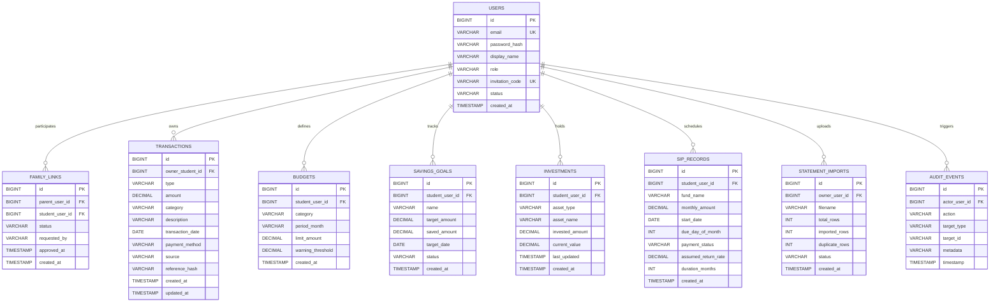

# Database Schema Specification

The schema is defined for MySQL 8.0+ and fully compatible with MySQL dialect in embedded H2 database for local testing.

## Entity Relationship Overview

## Relational Constraints & Types
- **Money Values**: Always `DECIMAL(12,2)` to guarantee exact accounting calculations without floating-point inaccuracies.
- **Indexes**: Indexed on `owner_student_id`, `transaction_date`, `category`, and `family_links (parent_user_id, student_user_id, status)`.
- **Foreign Keys**: `ON DELETE CASCADE` on student resources so data remains referentially intact.
