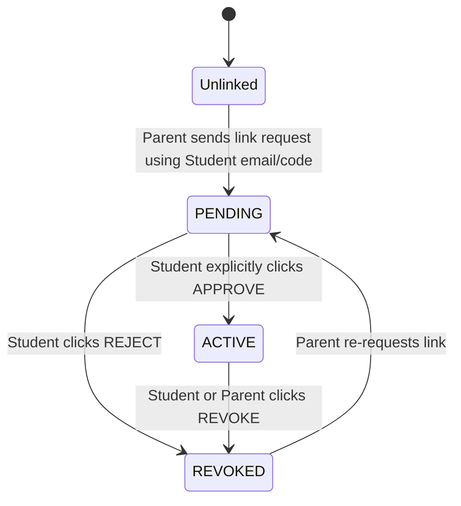

# Roles and Permissions Specification

## 1. Role Matrix

| Action / Capability | Student Role | Linked Parent (ACTIVE) | Unlinked / PENDING Parent | Unauthorized User |
| :--- | :---: | :---: | :---: | :---: |
| Register & Authenticate | Allowed | Allowed | Allowed | Allowed |
| View Own Profile | Allowed | Allowed | Allowed | Denied (401) |
| Create Income / Expense | Allowed | **DENIED (403)** | **DENIED (403)** | Denied (401) |
| Edit / Delete Own Transaction | Allowed | **DENIED (403)** | **DENIED (403)** | Denied (401) |
| View Student Transactions | Allowed (Own) | Allowed (Permitted Expenses Only) | **DENIED (403)** | Denied (401) |
| View Student Income Records | Allowed (Own) | **DENIED (403)** | **DENIED (403)** | Denied (401) |
| Manage Budgets (Create/Update/Delete) | Allowed | **DENIED (403)** | **DENIED (403)** | Denied (401) |
| View Budget Summaries | Allowed | Allowed (Read-only aggregate) | **DENIED (403)** | Denied (401) |
| Manage Savings Goals | Allowed | **DENIED (403)** | **DENIED (403)** | Denied (401) |
| View Savings Goals | Allowed | Allowed (Read-only progress) | **DENIED (403)** | Denied (401) |
| Manage Investments & SIPs | Allowed | **DENIED (403)** | **DENIED (403)** | Denied (401) |
| View Investment Portfolio | Allowed | Allowed (Read-only summary) | **DENIED (403)** | Denied (401) |
| Request Family Link | Allowed (Invite code) | Allowed (Send request) | Allowed (Send request) | Denied (401) |
| Approve / Reject Family Link | Allowed (Student only) | **DENIED (403)** | **DENIED (403)** | Denied (401) |
| Revoke Active Link | Allowed (Student & Parent) | Allowed (Student & Parent) | N/A | Denied (401) |
| Run Intelligent Features / What-If | Allowed | Allowed (Read-only analytics) | **DENIED (403)** | Denied (401) |
| Import Statements (CSV) | Allowed | **DENIED (403)** | **DENIED (403)** | Denied (401) |

---

## 2. Parent-Student Linking Lifecycle

### Security Guardrails:
1. **Explicit Student Consent**: A parent cannot unilaterally attach themselves to a student's records. A link is initialized in `PENDING` state and grants zero access until the student explicitly approves.
2. **Immediate Revocation**: The instant a student revokes a link, the status updates to `REVOKED`. Any subsequent attempt by the parent to fetch student data immediately returns `403 Forbidden`.
3. **Strict Parent Read-Only Enforcement**:
   - The backend enforces HTTP method restrictions: all `POST`, `PUT`, `DELETE` operations on transactions, budgets, goals, and portfolio items check that the caller possesses the `ROLE_STUDENT` authority and matches the owner ID.
   - Any mutation request by a parent returns `403 Forbidden` with the error message: `"Parents have strictly read-only access and cannot alter student records"`.
